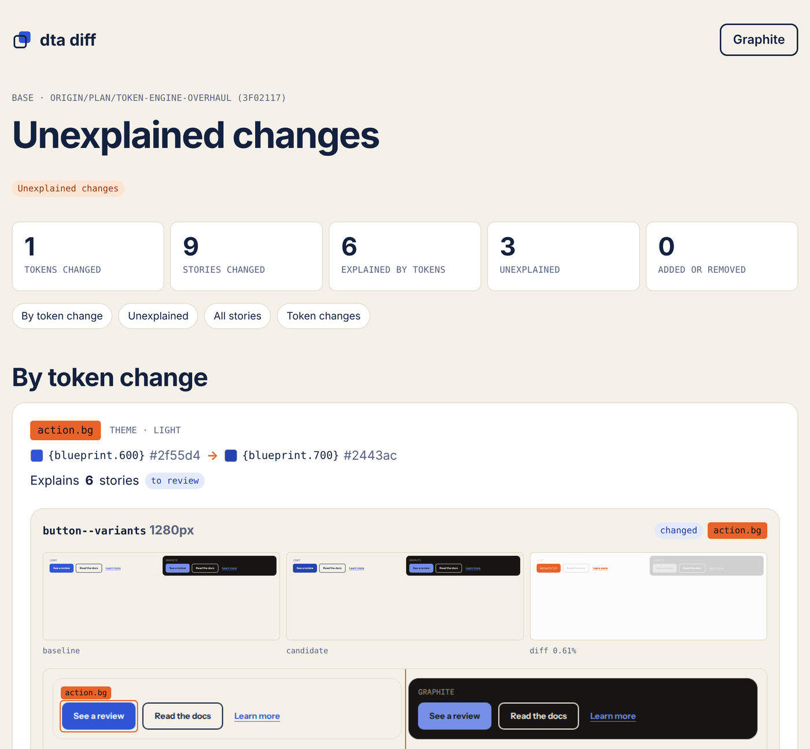
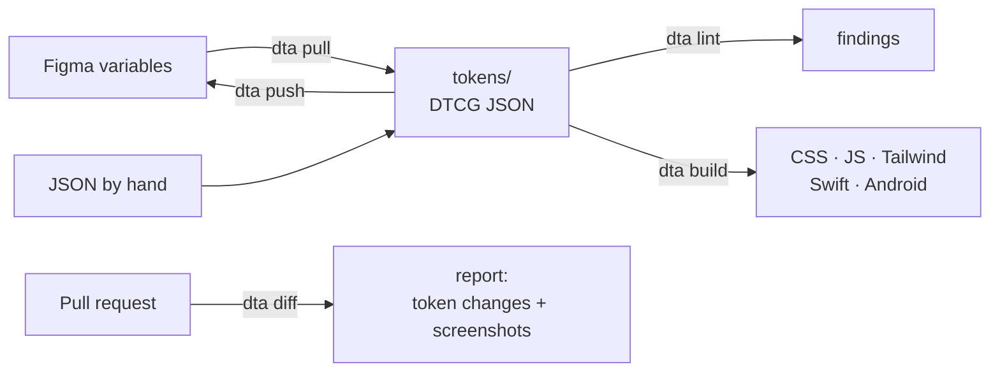

# Design Token Authority

**See what a token change does to your UI before it merges.**

[](https://www.npmjs.com/package/design-token-authority)
[](https://github.com/Fuasmattn/design-token-authority/actions/workflows/test.yml)
[](LICENSE)

DTA is a command-line tool for design tokens. It reads your tokens from Figma or plain [DTCG](https://tr.designtokens.org/format/) JSON, checks their structure, builds them into CSS, JavaScript, Tailwind and native code, and shows each change as one review: the token changes, the lint findings and the screenshots, grouped by the token that caused them. Same input, same result, on your machine, in CI or when an agent runs it.

<picture>
  <source media="(prefers-color-scheme: dark)" srcset="docs/readme/dta-diff-dark.png" />
  
</picture>

## Try it

| You have                       | Start here                                                                                                                              |
| ------------------------------ | --------------------------------------------------------------------------------------------------------------------------------------- |
| Two minutes and a browser      | The [playground](https://dta.martinprinz.dev/playground/): runs in your browser, uploads nothing                                        |
| Any Figma plan                 | Export your variables with a plugin, then `npm create dta` and pick the file ([Figma guide](https://dta.martinprinz.dev/guides/figma/)) |
| Figma Enterprise or JSON files | `npm create dta`, then `npx dta pull` for the REST API, or point DTA at your `tokens/` folder                                           |

Node.js 24.22.1 or newer. Then:

```sh
npx dta build   # tokens/ → CSS, JS, Tailwind (and Swift, Android XML, Compose when chosen)
npx dta lint    # broken aliases and your rules; exits 2 on errors
npx dta diff    # what changed against main, screenshots explained by token
```

`npm create dta` installs the package `design-token-authority`; after that, `dta` is its short name. Never run `npx dta` in a project without DTA installed: the npm name `dta` belongs to an unrelated package.

## Why

When tokens change every week:

- **Structure drifts.** Naming and layers break, and nobody notices. → `dta lint`
- **Code breaks quietly.** A renamed token is still used somewhere. → `dta diff` lists every token change, before and after
- **Screenshots pile up.** One colour change touches a hundred screens. → `dta diff` groups them by the token behind them

DTA does not dictate structure or naming: it takes your collections, modes and brands as they are.

## How it fits



## Commands

| Command       | What it does                                                                                                           |
| ------------- | ---------------------------------------------------------------------------------------------------------------------- |
| `dta init`    | Wizard that writes `dta.config.ts` and sets up `dta diff`; with a config, sets up or updates `dta diff`                |
| `dta pull`    | Figma → token files (REST API on Enterprise, `--from-file` with a plugin export)                                       |
| `dta push`    | Token files → Figma; dry run, typed confirmation, never deletes                                                        |
| `dta prune`   | Figma variables without a token → deleted, after a dry run or a typed confirmation                                     |
| `dta build`   | CSS custom properties, JavaScript, Tailwind v3 and v4, one theme per brand; Swift, Android XML and Compose when chosen |
| `dta lint`    | Dangling and circular aliases, default mode names, configurable rules                                                  |
| `dta graph`   | Alias graph: console, Markdown, DOT or interactive HTML                                                                |
| `dta diff`    | Token changes against a base; stories rendered at base and head, explained by token                                    |
| `dta analyze` | Which role each Figma collection plays                                                                                 |
| `dta clean`   | Removes token files and build output                                                                                   |

## Where it sits

DTA builds its outputs with [Style Dictionary](https://styledictionary.com) and converts a few known Figma plugin exports, so it fits next to the tools you already have. What it adds is the review step: a deterministic check of the token files and a visual diff of what a change does, in the pull request.

## Documentation

Everything is on **[dta.martinprinz.dev](https://dta.martinprinz.dev)**:
[Quick start](https://dta.martinprinz.dev/start/quick-start/) ·
[Core concepts](https://dta.martinprinz.dev/start/concepts/) ·
[dta diff in pull requests](https://dta.martinprinz.dev/guides/dta-diff-in-pull-requests/) ·
[Commands](https://dta.martinprinz.dev/reference/commands/)

## Contributing

Issues and pull requests are welcome; [good first issues](https://github.com/Fuasmattn/design-token-authority/labels/good%20first%20issue) are a good place to start. Work starts from a ticket in [`docs/tickets/`](docs/tickets/000-index.md), bigger changes from a spec. Coding agents read [`AGENTS.md`](AGENTS.md). Details: [Contribute](https://dta.martinprinz.dev/contribute/).

## License

MIT
